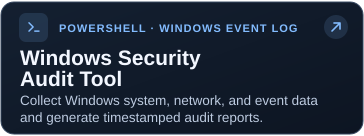
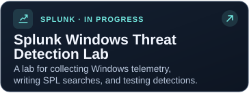
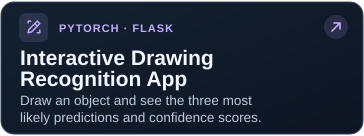
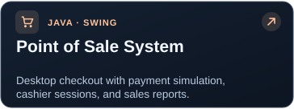
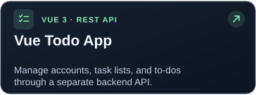

# Goobin Jung

### Computer Science & Cybersecurity

IT Operations Intern at American Fidelity  
B.S./M.S. student at Oklahoma Christian University

---

## About me

- **Education:** B.S./M.S. in Computer Science, Cybersecurity concentration at Oklahoma Christian University.
- **Honors:** President’s List and Order of the Sword and Shield National Honor Society (OSSNHS).
- **Experience:** IT operations at American Fidelity, university IT support, Samsung, and the Republic of Korea Army.
- **Certification:** CompTIA Security+, Google Cybersecurity Professional Certificate
- **Current focus:** Cybersecurity, PowerShell/Python automation, and learning Splunk and SPL through a personal lab.

## Featured projects

 

 

## Security exercises & simulations

| Activity | Focus |
| --- | --- |
| **Tata IAM Job Simulation** | Analyzed identity and access management requirements and proposed user lifecycle automation and Zero Trust access controls using RBAC, ABAC, PAM, and SSO. |
| **Mastercard Cybersecurity Job Simulation** | Analyzed phishing indicators, designed a simulated phishing campaign, reviewed results, and developed targeted security awareness training. |
| **Network Traffic Analysis with Wireshark** | Inspected DNS, DHCP, TCP, ICMP, and TLS traffic to understand communication patterns and troubleshoot network activity. |

## Certifications & training

| Credential or course | Type |
| --- | --- |
| **CompTIA Security+** | Professional certification |
| **Google Cybersecurity Professional Certificate** | Professional certificate |
| **Anthropic AI Fluency: Framework & Foundations** | Course completion |
| **AWS Cloud Practitioner Essentials** | Foundational cloud training |
| **National Cyber League (NCL) Participation Certificate** | Competition participation |
| **Udemy: Administration and Automation with PowerShell** | Course completion |

## Tools & technologies

**Programming & scripting**

**Technical experience & learning areas**

| Area | Technologies & concepts |
| --- | --- |
| Programming | Python, Java, C++, JavaScript, PowerShell, HTML/CSS, SQL, x86 Assembly, data structures and algorithms |
| Security | SIEM, log analysis, network security, incident response, risk management, IAM, NIST and ISO frameworks |
| Access management | RBAC, ABAC, PAM, SSO, least privilege, identity verification |
| Networking | TCP/IP, DNS, HTTP/HTTPS, DHCP, Wireshark |
| Cloud & web | AWS, REST APIs, Node.js, Vue.js, Apache, phpMyAdmin, Postman |
| Machine learning | PyTorch, CNNs, Flask |
| Systems & IT operations | Windows, Kali Linux, Ubuntu, Microsoft Intune, Entrust, Persona, ServiceNow, Zendesk, LogMeIn |
| Workflow & productivity | Git, Git Bash, Microsoft Excel, Microsoft Office, IT asset tracking, ticketing, project and process management |

Currently learning: Splunk, SPL, Windows event analysis, and AI security.  
Practice platforms: TryHackMe and National Cyber League (NCL).

<b>More about my experience</b>

| Organization | Role | Period |
| --- | --- | --- |
| American Fidelity | IT Operations Intern | September 2026 – Present |
| Oklahoma Christian University | IT Support Technician | June 2026 – August 2026 |
| Samsung | Construction and Facilities Management Associate | December 2022 – September 2023 |
| Republic of Korea Army | Field Artillery Radar Operator | July 2019 – February 2021 |

---

Learning how systems work, how they fail, and how to make them more secure.

